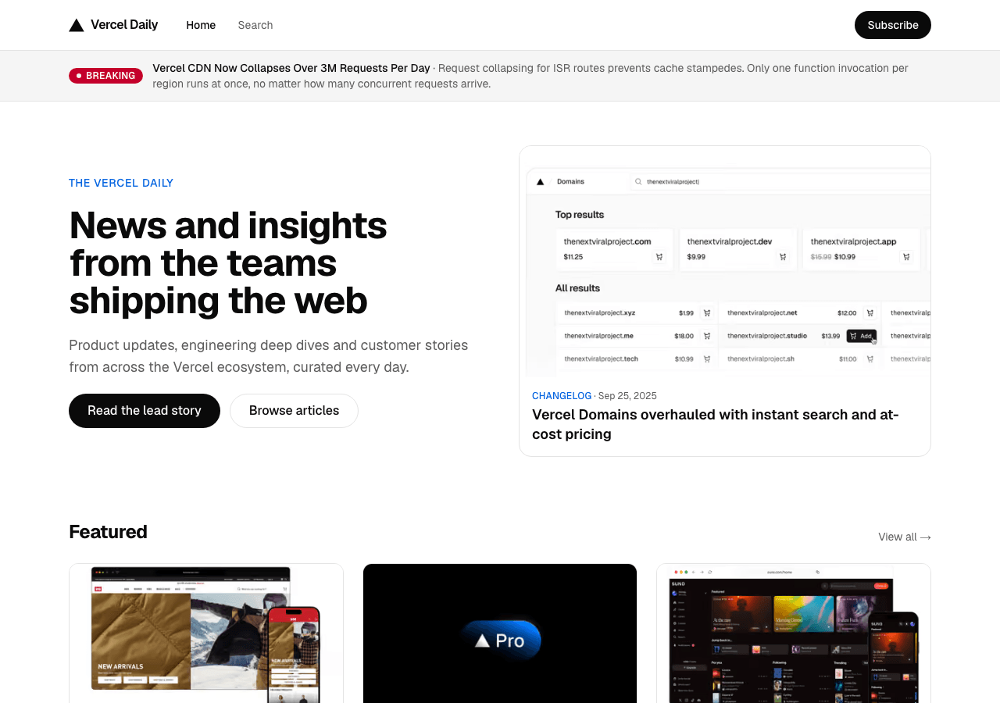
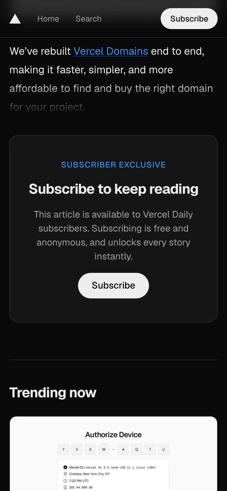
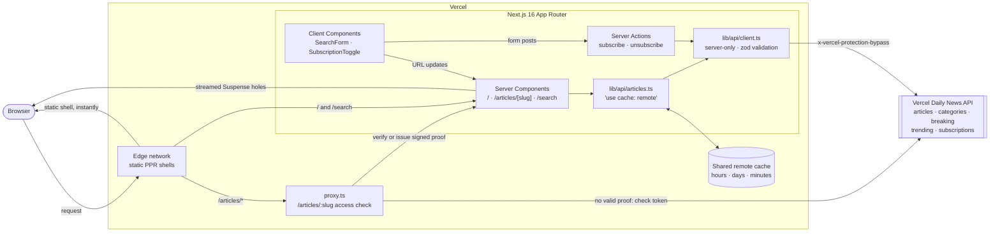
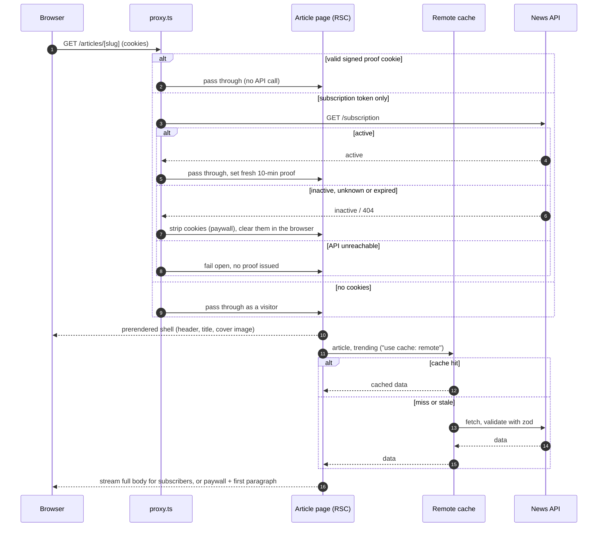

# Vercel Daily

[](https://github.com/chinnasvishnu999/vercel-daily/actions/workflows/ci.yml)
[](https://nextjs.org/blog/next-16)
[](https://react.dev/blog/2024/12/05/react-19)
[](tsconfig.json)

**Live demo: [vercel-daily-tau.vercel.app](https://vercel-daily-tau.vercel.app)**

A news publication built with **Next.js 16** (App Router, Cache Components) for the Vercel Partner Certification. It has a home page with a breaking-news banner and featured stories, article pages with trending stories and a subscriber paywall, and server-side search whose state lives in the URL. Content comes from the Vercel Daily News API.

<p>
  
  
</p>

## Highlights

- **Fast pages over a slow API.** The API takes 1–3 s per call. With partial prerendering and a shared remote cache, live pages fully load in about 0.3 s (down from 2–3 s), and no visitor waits on the API for cached content.
- **Server-side paywall with no leakage.** Non-subscribers never receive the article body, not in the HTML and not in the RSC payload. `proxy.ts` verifies subscriptions and rejects forged, expired or revoked tokens.
- **Search that behaves like a product.** Debounced, with a 3-character minimum, Enter to submit, a category filter, loading and empty states, and the URL as the single source of truth.
- **Tested everywhere.** Unit tests, plus Playwright end-to-end tests on desktop Chrome, Firefox and Safari and on mobile Chrome and Safari, run in CI.
- **Quality bar.** Lighthouse 100/100/100/100 on desktop and 99/100/100/100 on mobile, zero layout shift, TypeScript strict mode (with `noUncheckedIndexedAccess`), zod-validated API data, WCAG AA contrast, and security headers.

## Getting started

```bash
pnpm install
cp .env.example .env.local   # then fill in the values below
pnpm dev                     # http://localhost:3000
```

| Variable | Purpose |
| --- | --- |
| `VERCEL_DAILY_API_URL` | API base URL (defaults to `https://vercel-daily-news-api.vercel.app/api`) |
| `VERCEL_DAILY_API_BYPASS_TOKEN` | Deployment Protection bypass token, sent as `x-vercel-protection-bypass`. **Server-only.** |
| `SUBSCRIPTION_PROOF_SECRET` | 32+ character secret that signs the short-lived subscription proof cookie (`openssl rand -base64 48`). **Server-only.** |

None of these are prefixed with `NEXT_PUBLIC_`, none are committed, and none ever reach the browser.

| Script | What it does |
| --- | --- |
| `pnpm dev` / `pnpm build` / `pnpm start` | Develop, build, serve the production build |
| `pnpm lint` | Biome (lint + format check) |
| `pnpm check-types` | Generate route types, then `tsc --noEmit` |
| `pnpm test` | Unit tests (Vitest) |
| `pnpm test:e2e` | End-to-end tests (Playwright, 5 browser profiles). `PLAYWRIGHT_BASE_URL=https://… pnpm test:e2e` targets a deployment |

## Routes

| Route | What it shows |
| --- | --- |
| `/` | Breaking-news banner, hero with the latest story, 6 featured articles, subscribe CTA |
| `/articles/[slug]` | Article header, cover image, full body **or** paywall, 4 trending articles |
| `/search` | Keyword search + category filter, debounced, persisted in `?q=&category=` |

All pages share the root layout: a header with navigation and the subscription status, and a footer with the copyright year. The site also has `not-found`, `error` and `global-error` pages, a generated Open Graph image, `sitemap.xml` and `robots.txt`.

## Project structure

```
src/
├── app/
│   ├── layout.tsx               # Root layout + default metadata
│   ├── page.tsx                 # Home
│   ├── articles/[slug]/page.tsx # Article (generateStaticParams + generateMetadata)
│   ├── search/page.tsx          # Search (reads searchParams inside <Suspense>)
│   ├── actions/subscription.ts  # Server Actions: subscribe / unsubscribe
│   ├── not-found.tsx, error.tsx, global-error.tsx
│   └── opengraph-image.tsx, sitemap.ts, robots.ts, icon.svg
├── components/                  # Server Components by default; client ones are marked
├── lib/
│   ├── api/client.ts            # The only way to call the API (server-only, typed errors)
│   ├── api/schemas.ts           # zod schemas = runtime validation + types
│   ├── api/articles.ts          # Cached data access ("use cache: remote")
│   ├── subscription.ts          # Subscription API + cookie settings
│   ├── subscription-proof.ts    # HMAC-signed proof (Web Crypto)
│   └── inline-markdown.tsx      # Safe inline Markdown → React
└── proxy.ts                     # Access control for /articles/*
tests/
├── unit/                        # Vitest
└── e2e/                         # Playwright
```

## Architecture

### Overview



### Reading an article



### Rendering and caching (Cache Components)

`cacheComponents: true` is enabled, so every route is **partially prerendered**: a static shell is served instantly from the edge, and only per-visitor parts (subscription status, the paywall decision, search results) stream in behind `<Suspense>`.

The upstream API is slow (1–3 s per call, measured), so the rule is: **no visitor waits on it for content that can be cached.** All data access uses `"use cache: remote"`, a cache shared across server instances. That matters for request-time renders, where an instance-local in-memory cache would often miss on serverless.

| Data | Strategy | Why |
| --- | --- | --- |
| Articles, article detail | `cacheLife("hours")` + `cacheTag("articles")` | Editorial content changes rarely; tags allow targeted revalidation |
| Categories | `cacheLife("days")` | Practically static |
| Breaking news | `cacheLife("minutes")`, inside `<Suspense>` | The API returns a random item per call. It rotates every minute via stale-while-revalidate, so the banner stays dynamic without making anyone wait |
| Trending | `cacheLife("minutes")` per article, inside `<Suspense>` | Random per call; refreshed every minute in the background, always excluding the current article |
| Search results | `cacheLife("hours")` per query + category | First search for a term pays the API cost once; repeats are instant for everyone |
| Subscription status | Request time (`cookies()`), inside `<Suspense>` | Personal to each visitor; never cached |
| Copyright year | `"use cache"` component | Reading the clock isn't allowed while prerendering the shell |

All 18 articles are prerendered with `generateStaticParams`. I also measured a shorter, request-time profile for the rotating content: it blocked a request on every refresh, so the `minutes` profile was chosen deliberately.

### Subscription, paywall and access control

- **Model:** the API identifies an anonymous subscription by a token. The `subscribe` Server Action activates the visitor's token (or creates one if it's unknown or expired) and only then stores it in an **httpOnly, secure, `sameSite=lax` session cookie**, so it lasts for the browser session as specified. `unsubscribe` deactivates the token and deletes the cookies.
- **Read-your-own-writes:** both actions call `refresh()`, so the header, the paywall and the CTAs update in the same round trip.
- **Access control in `proxy.ts`:** before an article renders, the proxy checks the subscription:
  - **Signed proof:** after one successful API check it issues an HMAC-SHA256 **signed proof** cookie, valid for 10 minutes. The proof is bound to the token and its expiry, verified in constant time, and can't be forged, extended or reused for another token. Later requests are verified locally instead of costing a 1.5 s API call.
  - **Invalid token:** if the token is unknown, expired (24 h of inactivity) or inactive, the cookies are stripped from the request (so the page renders the paywall) and cleared in the browser.
  - **API outage:** the proxy fails open for an existing subscriber, without issuing a proof, rather than flashing a paywall. A definite "not found" or "inactive" always fails closed.
- **No content leakage:** the paywall decision happens on the server in `ArticleAccess`, which looks the article up by slug instead of receiving it as a prop. For a non-subscriber the response contains only the headline, image and first paragraph.
- **Progressive enhancement:** the forms post to Server Actions, so they work before JavaScript loads. With JavaScript, `useActionState` adds pending and error states.

### Search

- **URL as source of truth:** the server reads `searchParams`, validates them (the category must exist, the query is trimmed and length-limited) and filters through the API (`limit=5`). A refresh or a shared link shows the same results.
- **`SearchForm` (client):**
  - **Typing** searches automatically after 3+ characters, with a 300 ms debounce that resets on every keystroke.
  - **Enter** or the button searches immediately.
  - **Clearing** the input removes the stale query from the URL right away.
  - **The category filter** applies immediately.
  - **Back/forward** is synced through `popstate`, so in-flight navigations never overwrite typing.
- **Loading feedback:** `useTransition` keeps the previous results visible (dimmed) with a spinner and a live "Searching…" message for screen readers.

### Data layer

- `src/lib/api/client.ts` is the single, `server-only` entry point to the API. It adds the bypass header, unwraps the `{ success, data, error }` envelope and throws a typed `ApiError`.
- Every response is validated with **zod**, so the UI only handles trusted, typed data. Validation surfaced real API quirks:
  - Some titles have leading whitespace (trimmed).
  - In-article image blocks have an empty `src` (skipped instead of rendering broken images).
  - Single-item responses omit `meta`.
- Article text contains inline Markdown. `inline-markdown.tsx` renders links, bold, italic and code as React elements (never `dangerouslySetInnerHTML`) and only links `http(s)` URLs, so `javascript:` URLs can't get through.

### Security

- All secrets are server-only (`server-only` imports, no `NEXT_PUBLIC_`). Client bundles were checked to contain none of them.
- Security headers on every route: `X-Content-Type-Options`, `X-Frame-Options: DENY`, `Referrer-Policy`, `Permissions-Policy`. `X-Powered-By` is disabled, and Vercel adds HSTS.
- Subscription cookies are `httpOnly`, `secure` and `sameSite=lax`, and the proof cookie is signed and short-lived.
- URL input is validated before it reaches the API.

### Metadata and SEO

- **Root layout:** `metadataBase`, a title template (`%s | Vercel Daily`), and default description, Open Graph and Twitter metadata.
- **Every page** exports its own metadata. Articles use `generateMetadata` with `og:type=article`, the publish time, author, section, tags and the cover image.
- A generated default social image, `sitemap.xml`, `robots.txt` and canonical URLs.

### Performance and accessibility

- **Images:** `next/image` with `remotePatterns` scoped to the API's Blob store and AVIF/WebP output. The LCP image is preloaded, and fixed aspect-ratio frames give zero layout shift. Source images are up to 5186 px wide and 1.2 MB.
- **Fonts and theming:** Geist via `next/font`; semantic color tokens for light and dark mode, all at WCAG AA contrast or better.
- **Accessibility:** a skip link, landmarks, `aria-current` navigation, labelled controls, live regions for async states, and visible focus styles.
- **Lighthouse** (live deployment, home / article / search): desktop 100 for performance, accessibility, best practices and SEO; mobile 99 / 100 / 100 / 100. CLS 0 on every page.

## Testing

| Suite | Tool | Covers |
| --- | --- | --- |
| Unit (16 tests) | Vitest | Signed proof (round-trip, tampering, expiry, token binding, missing secret), safe inline Markdown (XSS and `javascript:` links), UTC date formatting, API schema validation |
| End-to-end (13 tests × 5 browsers) | Playwright | Layout, metadata and responsive layout on every page; home, article and trending content; the full subscribe → reload → unsubscribe flow; forged cookies; the 404 page; search debounce, URL state, category filter, Enter, empty state and clearing. Any console error fails the test |

The Playwright projects are Desktop Chrome, Desktop Firefox, Desktop Safari (WebKit), Mobile Chrome (Pixel 7) and Mobile Safari (iPhone 15).

**CI** (GitHub Actions, on every push and PR, plus a daily scheduled run):
- Lint, type check and unit tests.
- The full Playwright suite in all 5 browsers against the production deployment.

## Trade-offs and notes

- **Slugs in URLs:** articles use `/articles/[slug]`. The API accepts ids or slugs, and slugs are readable and stable.
- **Header status:** the header's subscription indicator trusts the cookie. Only article routes, where access matters, go through the proxy's verification.
- **Revocation delay:** a subscription revoked outside this site is detected when the 10-minute proof expires. Unsubscribing on this site takes effect immediately.
- **Unknown slugs:** they render the 404 page. With Partial Prefetching, the first request for an unlisted slug is served the app shell (status 200, `noindex`), and later requests return a real 404. In that case the header and footer render on the client.
